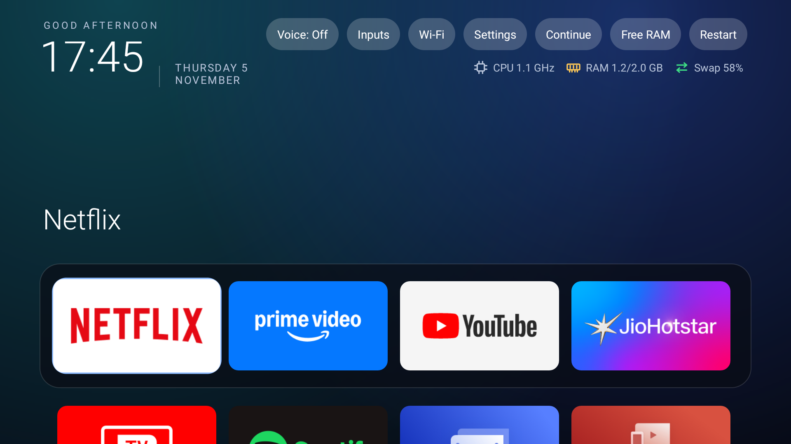

# Aurora TV Toolkit

**Take back an Android TV.** Read-first tools to see what your TV is doing, make it lighter and faster, block ads and trackers, and replace the clutter with a Home screen and a Live TV app you control. Every change is reversible.

[](CHANGELOG.md)
[](LICENSE)
[](docs/DEVICE-SUPPORT.md)
[](docs/DEVICE-SUPPORT.md)
[](https://github.com/andrewsavio/aurora-tv-toolkit/actions/workflows/ci.yml)



---

## Contents

- [Why](#why)
- [What is in the box](#what-is-in-the-box)
- [Quick start](#quick-start)
- [Commands](#commands)
- [Safety model](#safety-model)
- [Device support](#device-support)
- [Features](#features)
- [Known limits](#known-limits)
- [Claude Code skills](#claude-code-skills)
- [Contributing](#contributing)
- [Roadmap](#roadmap)
- [Versioning](#versioning)
- [License and disclaimer](#license-and-disclaimer)

## Why

Most Android TVs ship with preinstalled apps, background services, telemetry and a home screen you cannot change. This toolkit uses only what Android's own developer tools allow (`adb`, the package manager, app-standby controls and a regular home-screen app). Nothing needs root, and nothing modifies the system partition.

## What is in the box

| Part | What it does | Status |
|---|---|---|
| [`tools/tvkit.ps1`](tools/tvkit.ps1) | One command-line tool: detect, status, plan, apply, undo, RAM report, privacy audit, boot timing | v0.1.0, read paths tested on hardware |
| [`launcher/`](launcher) | **Aurora Home**: a light home screen with status chips, a dropdown for inputs and Wi-Fi, auto Free RAM, and a remote-button service | Tested on hardware |
| [`player/`](player) | Our own video, audio and photo player on Media3 ExoPlayer: named tracks, remembered choices, Continue Watching, Live TV, Dolby pass-through badge | Tested on hardware (see [Known limits](#known-limits)) |
| [`profiles/`](profiles) | Per-device rules. `generic-androidtv` is safe for any Android TV. `tcl-beyondtv2` is tested | Add your own with a pull request |
| [`blocklists/`](blocklists) | Ad and tracker blocklists, and the vendor servers found in a TCL device's apps | Tested as DNS rules |
| [`skills/`](skills) | Claude Code skills with the methods in this repo, so an assistant can follow them | Eight skills |
| [`docs/`](docs) | Device support, methods, privacy audit, troubleshooting, Samsung and other platforms | Living documents |

## Quick start

You need: Windows, macOS or Linux with [PowerShell 7](https://learn.microsoft.com/powershell/scripting/install/installing-powershell), and [Android platform-tools](https://developer.android.com/tools/releases/platform-tools) (`adb`) on your PATH.

1. **Turn on network debugging on the TV.** On Android TV: *Settings → Device Preferences → About*, select *Build* seven times to unlock *Developer options*, then enable *Network debugging* (or *ADB debugging* on older builds). Note the TV's IP address.
2. **Connect:**
   ```bash
   adb connect 192.168.1.50:5555
   ```
   Accept the prompt on the TV, and tick *Always allow*.
3. **Read what the TV is:**
   ```bash
   ./tools/tvkit.ps1 -Serial 192.168.1.50:5555 detect
   ./tools/tvkit.ps1 -Serial 192.168.1.50:5555 plan
   ```
   `plan` changes nothing. Read it before you do anything else.
4. **Apply, if you agree with the plan:**
   ```bash
   ./tools/tvkit.ps1 -Serial 192.168.1.50:5555 apply -Apply
   ```
5. **Undo at any time:**
   ```bash
   ./tools/tvkit.ps1 -Serial 192.168.1.50:5555 undo -Apply
   ```

To install Aurora Home, build the launcher with [`launcher/build.ps1`](launcher/build.ps1) and install it with `adb install -r launcher/build/app.apk`. Then press **Home** on the remote and choose Aurora Home as the default.

## Commands

| Command | Changes the TV? | What it tells you |
|---|---|---|
| `detect` | No | Brand, model, Android version, security patch, which profile applies |
| `status` | No | The current value of everything a profile would change |
| `plan` | No | What `apply` would do, with current values and the reason for each item |
| `apply -Apply` | Yes | Makes the profile's changes and writes a journal |
| `undo -Apply` | Yes | Reverses the last `apply` using the journal |
| `ram` | No | Memory used per running app (PSS), largest first |
| `audit` | No | Sensitive permissions granted, open internet connections, data sent per app |
| `boot` | No | Seconds since power-on and Android's boot milestones |

Options: `-Serial <ip:port>` (or `$env:ANDROID_SERIAL`), `-Profile <name or file>`, `-IncludeOptional` (also apply the optional items), `-Apply`.

## Safety model

- **Read first.** Every command except `apply -Apply` and `undo -Apply` only reads.
- **Reversible.** Apps are disabled *for user 0* (`pm disable-user`), which `pm enable` reverses. Settings, background limits and DNS are read before they are changed and written back by `undo`.
- **Journaled.** The journal is written before each change, so an interrupted run can still be undone. The journal is git-ignored because it holds device state.
- **Nothing system-level.** No root, no flashing, no edits to system partitions, no removal of system apps. Android 11 does not let `adb` disable another app's boot receiver, so the tool uses background restriction instead.
- **Optional is opt-in.** Anything that changes behaviour you might use (remote services, animation speed, DNS filtering) sits in the `optional` group.
- **No vendor binaries.** This repository does not contain any manufacturer's APK or firmware. You build the player into an app you own, as described in [docs/METHODS.md](docs/METHODS.md).

## Device support

Summary (full matrix in [docs/DEVICE-SUPPORT.md](docs/DEVICE-SUPPORT.md)):

| Platform | Status |
|---|---|
| TCL BeyondTV2, Android TV 11 | **Tested end to end** on hardware |
| Other Android TV and Google TV devices | Use `generic-androidtv`. Untested. Please send a device report |
| Fire TV (Fire OS, Android based) | Untested. Package names differ; expect a new profile |
| Samsung (Tizen), LG (webOS), most Hisense VIDAA models | **Not supported.** Different operating systems and tools. See [docs/SAMSUNG-AND-OTHER-PLATFORMS.md](docs/SAMSUNG-AND-OTHER-PLATFORMS.md) |

If your device is not listed, run `detect` and `plan`, then open a [device-support issue](https://github.com/andrewsavio/aurora-tv-toolkit/issues/new/choose). A report with your model and output is the most useful contribution you can make.

## Features

### Debloat, RAM and start-up
- Disable apps you do not need (per user, reversible). Profiles list each app and say why.
- Limit background work for streaming apps, so they stop starting themselves at power-on.
- Cancel scheduled jobs that bring an app back (for example YouTube's recommendations job).
- Measure RAM per app with `ram`, using each process's real proportional memory (PSS).
- **Aurora Home auto Free RAM:** when you return to Home after a while and memory is tight, cached background apps are closed. On the tested TV it freed about 166 MB.

### Privacy
- `audit` lists which apps hold sensitive permissions (microphone, camera, location, contacts, usage access, and so on), which internet connections are open, and how much data each app has sent. The method and its limits are in [docs/PRIVACY-AUDIT.md](docs/PRIVACY-AUDIT.md).
- DNS-level blocking of ads and trackers, with a list of the vendor servers found in the tested TV's apps. See [blocklists/](blocklists).

### Aurora Home (launcher)
- A plain Android home screen with no libraries, no network and no background work.
- Status chips (CPU clock, RAM, swap), Inputs and Wi-Fi dropdowns, a Free RAM button, and a restart shortcut.
- Pre-rendered tiles, one shared easing curve for focus, and a name under every app.

### Player and Live TV
- Named audio and subtitle tracks read from the file (for example "Hindi (Org AMZN DDP 5.1 640kbps) - Dolby Digital Plus 5.1"), not "Track 2".
- Remembers the audio track, subtitles, speed, picture size and position for each video, and resumes it.
- **Dolby pass-through:** sends Dolby Digital Plus to the TV's own decoder when the TV accepts it (verified on the tested TV; Atmos is not yet verified). A black badge in the top-left shows the format.
- **Live TV:** an IPTV playlist with categories, favourites, recently watched, search with an on-screen keyboard, channel logos, and channel up and down while watching.

### Remote buttons
- **T button → Live TV** (the T key on the tested TV's remote). It is a small accessibility service that only sees key presses.
- **Hold Back → Home** from any app. A short Back still reaches the app as normal. *Built; awaiting a hardware test.*

## Known limits

- **Only one device is tested** (TCL BeyondTV2). Everything else is a best effort until someone reports back.
- **YouTube ads inside videos cannot be removed** with DNS or the tools here. YouTube's ads come from the same servers as the video.
- **Dolby Digital (AC3) pass-through:** on the tested TV, the audio system only accepted Dolby Digital Plus and AC-4 for direct output. Plain Dolby Digital is decoded instead.
- **Atmos** was not tested with a real Atmos file.
- **Accessibility service:** the T button and Hold Back need the service switched on once in *Settings → Accessibility*. Updating Aurora Home can detach it; toggling it off and on fixes that.
- **Media Manager** (the player's integration into the TV's own media app) is not in this repo, because it is built on a vendor app that we do not redistribute.
- **Playlists:** streams come from a public community list. Check the law where you live, and expect some channels to be geo-blocked or offline.

## Claude Code skills

The [`skills/`](skills) folder holds Claude Code skills that describe these methods step by step, so an assistant can follow them without rediscovering them:

- `android-tv-adb`: connecting and the permission model of the shell user
- `android-tv-platform-detection`: working out which family a TV belongs to before doing anything
- `android-tv-debloat`: safe, reversible app and job changes, with RAM measurement
- `android-tv-startup-speed`: start-up and background behaviour
- `android-tv-privacy-audit`: permissions, connections and data sent
- `android-tv-remote-keys`: remapping remote buttons with an accessibility service
- `android-tv-dolby-passthrough`: audio formats, passthrough and the Dolby badge
- `android-tv-launcher-build`: building an Android APK without Gradle, and the d8 and zipalign traps

To use them with Claude Code, copy the folders into `~/.claude/skills/`.

## Contributing

Contributions are welcome, especially device reports. Please read [CONTRIBUTING.md](CONTRIBUTING.md) first. In short: test with `plan` before `apply`, never commit vendor binaries or keys, and keep changes reversible.

- Found a bug? Use the [bug report](https://github.com/andrewsavio/aurora-tv-toolkit/issues/new?template=bug_report.yml).
- Have a TV we don't support? Use the [device-support form](https://github.com/andrewsavio/aurora-tv-toolkit/issues/new?template=device_support.yml).
- Want a change? Open a [feature request](https://github.com/andrewsavio/aurora-tv-toolkit/issues/new?template=feature_request.yml) or send a pull request with the [template](.github/PULL_REQUEST_TEMPLATE.md).
- Security problem? See [SECURITY.md](SECURITY.md). Please do not open a public issue for it.

## Roadmap

- **0.2:** Profiles for Fire TV and Sony and Philips Android TV, once someone has reported a device.
- **0.2:** Build the launcher and player in CI, with a generated test APK.
- **0.3:** Per-device journals in one folder, and a `tvkit report` command that writes a shareable support bundle with secrets removed.
- **Later:** Read-only Samsung (Tizen) support, if the Tizen tooling allows the same checks. See [docs/SAMSUNG-AND-OTHER-PLATFORMS.md](docs/SAMSUNG-AND-OTHER-PLATFORMS.md).

## Versioning

This project uses [Semantic Versioning](https://semver.org). The version in the badge is the one in [CHANGELOG.md](CHANGELOG.md). Breaking changes to a profile format bump the minor version while the project is below 1.0.

## License and disclaimer

Released under the [MIT License](LICENSE).

This project is not affiliated with TCL, Google, Samsung, Amazon, Netflix, YouTube, JioHotstar, Spotify or any other company named here. Product names are used only to describe compatibility. Changing system settings can break features, void warranties or expose the device to the risks of any open debugging port. Keep network debugging off when you do not need it. You use these tools at your own risk.

## Acknowledgements

- [AndroidX Media3](https://github.com/androidx/media) (Apache-2.0) for the playback engine, downloaded at build time.
- [Guava](https://github.com/google/guava) (Apache-2.0), also downloaded at build time.
- The public IPTV community playlist used by Live TV is maintained at [iptv-org](https://github.com/iptv-org/iptv).
